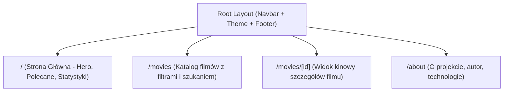
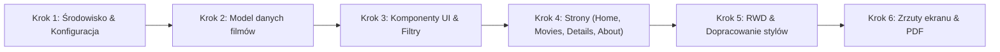

# Raport z Analizy Projektu: Movie Library (Biblioteka Filmów)

## 1. Wprowadzenie i Kontekst
Niniejszy raport zawiera szczegółową analizę stanu wyjściowego projektu stworzonego podczas zajęć laboratoryjnych oraz wytycznych z dokumentu `task/zadanie1 - programowanie i testowanie aplikacji webowych.pdf` (oraz jego kopii w `resources/`).

- **Student:** Oscar Hanke (album: 89607)
- **Przypisany temat:** **1. Movie Library – biblioteka filmów**
- **Cel:** Przekształcenie wersji demonstracyjnej aplikacji (prostej galerii zdjęć) we w pełni funkcjonalną, nowoczesną aplikację SPA dedykowaną bibliotece filmów, z własnym designem, responsywnością i kompletem widoków.

---

## 2. Analiza Stanu Istniejącego (Stan Zastany – "As-Is")

### 2.1. Zastosowany Stos Technologiczny
Kod demonstracyjny z zajęć bazuje na:
- **Next.js 15 (App Router)** – widoczne m.in. w asynchronicznym dostępie do parametrów ścieżki (`params: Promise<{ id: string }>`) w `PhotoDetails` (`app/gallery/[id]/page.tsx`).
- **React 19 / TypeScript** – typowanie komponentów, stron i modeli danych.
- **Tailwind CSS v4** – w pliku `app/globals.css` użyto nowej dyrektywy `@import "tailwindcss";` oraz zmiennych `@theme inline`.
- **Google Fonts (Geist & Geist Mono)** skonfigurowane w `app/layout.tsx`.

### 2.2. Struktura Kodu i Komponentów
```
app/
├── about/
│   └── page.tsx              # Prosta zaślepka tekstowa ("About page works")
├── components/
│   ├── NavBar.tsx             # Górny pasek nawigacyjny (Home, Gallery, About)
│   ├── PhotoCard.tsx          # Karta pojedynczego zdjęcia (używa next/image)
│   └── PhotoGrid.tsx          # Responsywna siatka kart (1-4 kolumny)
├── data/
│   └── photos.ts              # Model Photo i 4 elementy testowe z Pexels
├── gallery/
│   ├── [id]/
│   │   └── page.tsx           # Szczegóły zdjęcia wg id
│   └── page.tsx               # Strona galerii z siatką PhotoGrid
├── favicon.ico
├── globals.css                # Style bazowe Tailwind v4
├── layout.tsx                 # Główny szablon aplikacji z paskiem NavBar
└── page.tsx                   # Strona główna - zaślepka ("home works")
```

### 2.3. Zidentyfikowane Braki i Ograniczenia Stanu Obecnego
1. **Brak konfiguracji projektu w repozytorium:**
   W katalogu głównym brakuje plików konfiguracyjnych:
   - `package.json` (skrypty i zależności `next`, `react`, `react-dom`, `tailwindcss`, `typescript`, `@types/*`),
   - `tsconfig.json` (konfiguracja kompilatora TypeScript i aliasów ścieżek np. `@/*`),
   - `next.config.ts` / `next.config.mjs` (kluczowe m.in. dla konfiguracji `images.remotePatterns` przy używaniu `next/image` z zewnętrznymi adresami URL plakatów).
2. **Niedopracowany layout i błędy typów:**
   - W `app/layout.tsx` użyto `LayoutProps<"/">`, co bez wygenerowanych typów Next.js powoduje błąd kompilacji TypeScript. Standardowo powinno być `{ children: React.ReactNode }`.
3. **Szczątkowa zawartość podstron:**
   - Strona główna (`app/page.tsx`) i strona O projekcie (`app/about/page.tsx`) to jedynie surowe napisy w `<h2>`.
4. **Nawigacja i RWD:**
   - `NavBar.tsx` nie posiada wersji mobilnej (brak menu hamburgera na wąskich ekranach), brak podświetlenia aktywnej trasy oraz brak logotypu.
5. **Model danych zorientowany na zdjęcia, a nie filmy:**
   - Schemat `app/data/photos.ts` posiada jedynie pola `id`, `title`, `description`, `image`, `date`. Filmy wymagają znacznie bogatszego zestawu metadanych.

---

## 3. Analiza Wymagań dla Zadania "1. Movie Library"

Zgodnie z instrukcją z pliku PDF:

### 3.1. Wymagane Elementy Funkcjonalne
- **Strona główna (Home):**
  - Wizualne wprowadzenie do biblioteki filmów (Hero Section).
  - Wyróżnione hity filmowe / polecane tytuły.
  - Szybkie statystyki (np. liczba filmów, liczba gatunków, średnia ocena).
  - Przyciski Call-To-Action (przejście do katalogu filmów).
- **Nawigacja pomiędzy widokami (SPA):**
  - Szybkie przełączanie tras w Next.js bez przeładowania całej strony (`next/link`).
  - Spójny pasek nawigacyjny: *Strona Główna*, *Katalog Filmów*, *O Projekcie / Twórca*.
- **Widok listy elementów (Katalog Filmów):**
  - Estetyczna siatka kart z plakatami filmowymi.
  - Informacje na karcie: tytuł, rok premiery, czas trwania, gatunek (tagi), ocena punktowa (np. 8.5/10 z gwiazdką).
  - Interaktywność (elementy dodatkowe):
    - Wyszukiwarka filmów w czasie rzeczywistym po tytule / reżyserze,
    - Filtrowanie według gatunku (np. Wszystkie, Sci-Fi, Dramat, Akcja, Kryminał, Animacja),
    - Sortowanie (wg oceny, roku wydania, tytułu A-Z).
- **Widok szczegółowy wybranego elementu (`/movies/[id]`):**
  - Dynamiczny routing App Routera.
  - Panoramiczne tło filmowe (Backdrop) z gradientem i efektem głębi.
  - Wyraźny pionowy plakat filmowy.
  - Szczegółowe metadane:
    - Tytuł i tytuł oryginalny,
    - Rok premiery, kategoria wiekowa, czas trwania,
    - Reżyser i obsada aktorska,
    - Wskaźnik ocen (np. ocena krytyków / widzów),
    - Pełny opis fabuły (synopsis),
    - Link/przycisk do obejrzenia zwiastuna (np. trailer YouTube),
  - Wygodny przycisk powrotu do katalogu filmów.
- **Responsywny interfejs (RWD):**
  - Pełna responsywność na smartfonach, tabletach i ekranach desktopowych.
  - Mobilne menu w pasku nawigacyjnym.
  - Siatka kart automatycznie skalująca się od 1 do 4 kolumn w zależności od szerokości okna.
- **Własny spójny wygląd aplikacji (Design & UI/UX):**
  - Nowoczesny, kinowy styl (Cinema Dark Theme):
    - Tło: głębokie odcienie grafitu/czerni (`bg-slate-950`, `bg-zinc-900`),
    - Akcenty: złoto filmowe / amber (`text-amber-400`, `bg-amber-500`),
    - Karty z subtelnym obramowaniem (`border-slate-800`), cieniami i płynnym efektem hover (zoom plakatu, podświetlenie krawędzi).
  - Czytelna, elegancka typografia i badge z gatunkami.
- **Wymóg dokumentacji końcowej:**
  - Załączenie do projektu pliku PDF ze zrzutami ekranu przedstawiającymi:
    1. Stronę główną,
    2. Widok listy elementów (katalog filmów),
    3. Widok szczegółowy filmu,
    4. Wersję responsywną na mniejszym ekranie (mobile).

---

## 4. Projekt Architektury Docelowej

### 4.1. Model Danych (`Movie`)
W miejsce `Photo` tworzymy dedykowany model `Movie`:
```typescript
export interface Movie {
  id: string;
  title: string;
  originalTitle?: string;
  year: number;
  genre: string[];
  director: string;
  cast: string[];
  duration: string; // np. "2h 28min"
  rating: number;   // np. 8.8
  ageRating: string;// np. "16+", "PG-13"
  poster: string;   // pionowy plakat
  backdrop: string; // panoramiczne tło
  description: string; // krótka zajawka na kartę
  synopsis: string;    // pełny opis fabuły
  trailerUrl?: string; // link do oficjalnego zwiastuna
  featured?: boolean;  // wyróżniony na stronie głównej
}
```

### 4.2. Mapa Podstron (Routing)


---

## 5. Plan Realizacji Krok po Kroku



1. **Krok 1 – Konfiguracja środowiska:**
   - Utworzenie `package.json` z niezbędnymi bibliotekami (Next 15, React 19, Tailwind v4, ikony Lucide React do oznaczeń gwiazdek/czasu/filmów).
   - Utworzenie `tsconfig.json` z aliasem `@/*`.
   - Utworzenie `next.config.ts` z obsługą domen zewnętrznych dla plakatów i teł (`images.unsplash.com`, itp.).
   - Instalacja zależności poleceniem `npm install`.

2. **Krok 2 – Baza danych i model filmów:**
   - Stworzenie pliku `app/data/movies.ts` zawierającego zróżnicowaną kolekcję filmów (8–12 klasyków i hitów filmowych, np. *Incepcja*, *Interstellar*, *Mroczny Rycerz*, *Pulp Fiction*, *Diuna*, *Spider-Man*, *Ojciec Chrzestny*).

3. **Krok 3 – Komponenty interfejsu użytkownika:**
   - `NavBar.tsx`: responsywny pasek z logo, linkami i mobilnym drawerem/hamburgerem.
   - `Footer.tsx`: stopka aplikacji w kinowym stylu.
   - `MovieCard.tsx`: karta filmu z plakatem, badge'em oceny, tagami gatunków i efektem zoom/glow.
   - `MovieFilter.tsx`: komponent z polem wyszukiwania, wyborem gatunku oraz sortowaniem.

4. **Krok 4 – Wdrożenie podstron:**
   - `app/page.tsx`: Strona główna z sekcją Hero, banerem wyróżnionego filmu, siatką polecanych filmów i sekcją statystyk.
   - `app/movies/page.tsx`: Pełny katalog filmów z dynamicznym filtrowaniem po stronie klienta.
   - `app/movies/[id]/page.tsx`: Widowiskowa strona szczegółów z tłem backdrop, specyfikacją techniczną, obsadą i linkiem do zwiastuna.
   - `app/about/page.tsx`: Nowoczesna strona opisująca projekt, autora (Oscar Hanke) i cele akademickie.

5. **Krok 5 – Weryfikacja i testy:**
   - Uruchomienie deweloperskie (`npm run dev`) i build produkcyjny (`npm run build`).
   - Testy responsywności (mobile 375px, tablet 768px, desktop 1280px+).

6. **Krok 6 – Przygotowanie dokumentacji i pliku PDF:**
   - Wygenerowanie zrzutów ekranu wymaganych 4 widoków i utworzenie pliku PDF do oddania zadania.
