# Raport z Analizy Projektu: Movie Library (Biblioteka Filmów)

## 1. Wprowadzenie i Kontekst
Niniejszy raport zawiera szczegółową analizę stanu wyjściowego projektu stworzonego podczas zajęć laboratoryjnych, wytycznych z dokumentu `task/zadanie1 - programowanie i testowanie aplikacji webowych.pdf` oraz bezwzględnych zasad projektowych zawartych w [resources/RULES.md](file:///C:/Users/steam/IdeaProjects/programowanie-aplikacji-webowych/resources/RULES.md).

- **Student:** Oscar Hanke (album: 89607)
- **Przypisany temat:** **1. Movie Library – biblioteka filmów**
- **Cel:** Przekształcenie wersji demonstracyjnej aplikacji we w pełni funkcjonalną, nowoczesną aplikację SPA dedykowaną bibliotece filmów, zbudowaną zgodnie z zasadami **SOLID**, podejściem **Building Blocks**, pełnym pokryciem testami jednostkowymi/integracyjnymi oraz rygorystycznymi standardami czytelności i nazewnictwa.

---

## 2. Analiza Zasad Projektowych (`RULES.md`) i Ich Wpływ na Architekturę

Zgodnie z plikiem [resources/RULES.md](file:///C:/Users/steam/IdeaProjects/programowanie-aplikacji-webowych/resources/RULES.md), projekt musi spełniać następujące kryteria inżynieryjne:

### 2.1. Architektura "Building Blocks" & SOLID
1. **Single Responsibility Principle (S):**
   - Komponenty React odpowiadają wyłącznie za renderowanie widoku ("dumb/presentational components").
   - Cała logika biznesowa, operacje na danych, filtrowanie, wyszukiwanie, formatowanie czasu i kalkulacja ocen są wyekstrahowane do wyspecjalizowanych serwisów.
2. **Open/Closed Principle (O):**
   - Projektowanie oparte na interfejsach (`IMovieRepository`, `IMovieFilterService`, `IRatingCalculator`), co pozwala na dodawanie nowych kryteriów filtrowania lub źródeł danych bez modyfikowania istniejącego kodu.
3. **Liskov Substitution Principle (L):**
   - Implementacje interfejsów (np. `InMemoryMovieRepository`) mogą być w każdej chwili zastąpione inną implementacją (np. `ApiMovieRepository`) bez naruszenia działania serwisów wyższego rzędu.
4. **Interface Segregation Principle (I):**
   - Małe, dedykowane interfejsy zamiast jednego monolitycznego kontraktu (np. osobny interfejs dla kryteriów wyszukiwania, osobny dla formatowania metadanych, osobny dla dostępu do danych).
5. **Dependency Inversion Principle (D):**
   - Serwisy nie tworzą swoich zależności wewnątrz, lecz otrzymują je przez konstruktor (Dependency Injection). Moduły wysokiego poziomu zależą od abstrakcji (interfejsów).

### 2.2. Standardy Testowania (Test-First & Pełne Pokrycie)
- Każdy nowo tworzony serwis, kalkulator oraz funkcja transformująca dane posiada dedykowane testy jednostkowe (Unit Tests).
- Narzędzie testowe: **Vitest** (zapewniające natywną obsługę TypeScript i ESM oraz błyskawiczne wykonywanie testów).
- Obowiązkowe uruchamianie zestawu testów po każdej zmianie w kodzie (`npm run test`), gwarantujące brak regresji.

### 2.3. Konwencje Nazewnictwa (Self-Explanatory & Zero Skrótów)
- Całkowity zakaz skracania nazw (np. `MovieDatabase` zamiast `MovDb`, `movieIdentifier` zamiast `movId`, `selectedMovieCategory` zamiast `cat`).
- Kod ma strukturę samoopisującej się dokumentacji.

---

## 3. Analiza Stanu Istniejącego (Stan Zastany – "As-Is")

### 3.1. Zastosowany Stos Technologiczny
- **Next.js 15 (App Router)** – widoczne m.in. w asynchronicznym dostępie do parametrów ścieżki (`params: Promise<{ id: string }>`) w [PhotoDetails](file:///C:/Users/steam/IdeaProjects/programowanie-aplikacji-webowych/app/gallery/[id]/page.tsx#L12-L15).
- **React 19 / TypeScript**.
- **Tailwind CSS v4** – dyrektywa `@import "tailwindcss";` w [globals.css](file:///C:/Users/steam/IdeaProjects/programowanie-aplikacji-webowych/app/globals.css#L1).
- **Google Fonts (Geist & Geist Mono)** w [layout.tsx](file:///C:/Users/steam/IdeaProjects/programowanie-aplikacji-webowych/app/layout.tsx#L6-L14).

### 3.2. Identyfikacja Braków Technicznych
1. **Brak konfiguracji projektu w repozytorium:**
   Brak `package.json`, `tsconfig.json`, `next.config.ts`, `vitest.config.ts`.
2. **Niedopracowany layout:**
   Błąd typu `LayoutProps<"/">` w `app/layout.tsx` (zamiana na `{ children: React.ReactNode }`).
3. **Puste widoki:**
   Strona główna i strona O nas to surowe szkielety z `<h2>`.
4. **Brak logiki biznesowej i testów:**
   Obecnie w kodzie nie ma żadnych testów jednostkowych ani wydzielonych serwisów.

---

## 4. Projekt Architektury Docelowej (Zgodny z SOLID i Building Blocks)

```mermaid
flowchart TD
    subgraph UI ["Prezentacja / Komponenty UI (Dumb Components)"]
        HomePage["app/page.tsx (Widok Główny)"]
        MoviesPage["app/movies/page.tsx (Katalog Filmów)"]
        MovieDetailPage["app/movies/[id]/page.tsx (Widok Szczegółowy)"]
        AboutPage["app/about/page.tsx (O Projekcie)"]
        MovieCard["components/MovieCard.tsx"]
        MovieGrid["components/MovieGrid.tsx"]
        MovieSearchFilter["components/MovieSearchFilterBar.tsx"]
        NavigationBar["components/NavigationBar.tsx"]
        ApplicationFooter["components/ApplicationFooter.tsx"]
    end

    subgraph DomainServices ["Warstwa Domenowa i Serwisy (SOLID)"]
        MovieService["MovieService (Implementuje IMovieService)"]
        MovieFilterService["MovieFilterService (Implementuje IMovieFilterService)"]
        MovieFormatterService["MovieFormatterService (Formatowanie czasu, ocen, dat)"]
    end

    subgraph DataAccess ["Warstwa Dostępowa do Danych"]
        InMemoryMovieRepository["InMemoryMovieRepository (Implementuje IMovieRepository)"]
        MovieSeedData["app/data/moviesData.ts (Statyczna baza filmów)"]
    end

    subgraph Tests ["Zestaw Testów (Vitest)"]
        MovieServiceTest["MovieService.test.ts"]
        MovieFilterServiceTest["MovieFilterService.test.ts"]
        MovieFormatterServiceTest["MovieFormatterService.test.ts"]
        IntegrationTest["MovieLibraryIntegration.test.ts"]
    end

    HomePage --> MovieService
    MoviesPage --> MovieService
    MoviesPage --> MovieFilterService
    MovieDetailPage --> MovieService
    MovieCard --> MovieFormatterService

    MovieService --> InMemoryMovieRepository
    InMemoryMovieRepository --> MovieSeedData

    MovieServiceTest --> MovieService
    MovieFilterServiceTest --> MovieFilterService
    MovieFormatterServiceTest --> MovieFormatterService
    IntegrationTest --> MovieService
    IntegrationTest --> MovieFilterService
```



### 4.1. Interfejsy Domenowe (Interface Segregation)
```typescript
// contracts/IMovie.ts
export interface IMovie {
    readonly identifier: string;
    readonly title: string;
    readonly originalTitle: string;
    readonly releaseYear: number;
    readonly genres: readonly string[];
    readonly director: string;
    readonly castMembers: readonly string[];
    readonly durationInMinutes: number;
    readonly viewerRating: number;
    readonly ageRating: string;
    readonly posterImageUrl: string;
    readonly backdropImageUrl: string;
    readonly shortDescription: string;
    readonly detailedSynopsis: string;
    readonly trailerYouTubeUrl: string;
    readonly isFeatured: boolean;
}

// contracts/IMovieRepository.ts
export interface IMovieRepository {
    getAllMovies(): Promise<readonly IMovie[]>;
    getMovieByIdentifier(identifier: string): Promise<IMovie | null>;
    getFeaturedMovies(): Promise<readonly IMovie[]>;
}

// contracts/IMovieFilterCriteria.ts
export interface IMovieFilterCriteria {
    readonly searchQuery: string;
    readonly selectedGenre: string;
    readonly sortOrder: "RATING_DESCENDING" | "YEAR_DESCENDING" | "TITLE_ASCENDING";
}

// contracts/IMovieFilterService.ts
export interface IMovieFilterService {
    filterAndSortMovies(
        movies: readonly IMovie[],
        filterCriteria: IMovieFilterCriteria
    ): readonly IMovie[];
    extractUniqueGenres(movies: readonly IMovie[]): readonly string[];
}
```

---

## 5. Plan Realizacji Krok po Kroku

1. **Krok 1: Przygotowanie środowiska i konfiguracji narzędzi**
   - Utworzenie `package.json` (Next.js 15, React 19, TypeScript, Tailwind CSS v4, Lucide React, Vitest).
   - Utworzenie `tsconfig.json`, `next.config.ts`, `vitest.config.ts`.
   - Instalacja pakietów (`npm install`) i sprawdzenie działania środowiska.
2. **Krok 2: TDD – Testy i Implementacja Warstwy Domenowej**
   - Zdefiniowanie interfejsów w `app/contracts/`.
   - Napisanie testów jednostkowych dla `MovieFormatterService`, `MovieFilterService` oraz `MovieService`.
   - Implementacja serwisów tak, aby wszystkie testy w Vitest przeszły na zielono.
3. **Krok 3: Baza filmów i Repozytorium**
   - Przygotowanie bazy `moviesData.ts` (10–12 zróżnicowanych filmów o pełnych metadanych).
   - Implementacja `InMemoryMovieRepository` wraz z testami integracyjnymi.
4. **Krok 4: Komponenty Prezentacyjne (UI Building Blocks)**
   - `NavigationBar` (z responsywnym menu mobilnym).
   - `ApplicationFooter`.
   - `MovieCard`, `MovieGrid`.
   - `MovieSearchFilterBar` (wyszukiwarka na żywo, wybór gatunku, sortowanie).
5. **Krok 5: Wdrożenie Podstron**
   - `app/page.tsx`: Strona główna z sekcją Hero, polecanymi filmami i statystykami.
   - `app/movies/page.tsx`: Katalog z filtrami.
   - `app/movies/[id]/page.tsx`: Kinowy widok szczegółowy z tłem backdrop, pełną obsadą i zwiastunem.
   - `app/about/page.tsx`: Strona informacyjna o autorze i technologiach.
6. **Krok 6: Weryfikacja końcowa i raport ze zrzutami ekranu do PDF**
   - Uruchomienie pełnego zestawu testów (`npm run test`).
   - Weryfikacja RWD na urządzeniach mobilnych i desktopie.
   - Przygotowanie materiałów do pliku PDF ze zrzutami ekranu zgodnie z wytycznymi zadania.
